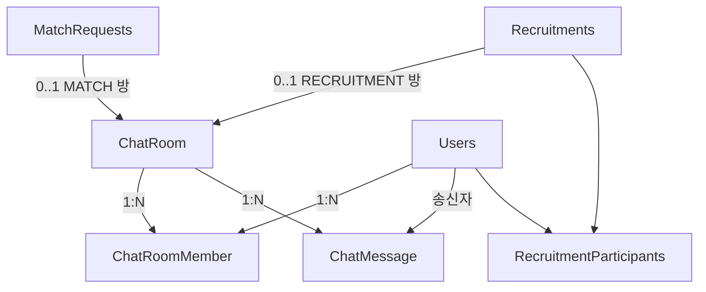

# 이룸매이트 매칭·모집 게시판 통합 채팅 고도화 상세 설계서

> **문서 목적**: Codex가 이 문서를 참조해 기존 `MATCH` 1:1 채팅을 망가뜨리지 않으면서, 모집 게시판(`RECRUITMENT`)의 단체채팅을 단계적으로 구현하기 위한 설계·정책·검증 기준.
>
> **대상 저장소**: https://github.com/ALOC-dev/6th-project-irummate-server-2026 (`test` 브랜치)
>
> **코드 확인 기준**: 2026-11-19에 확인한 `test` 커밋 `610e76c7db31081dfa4a7e6e676511190e28d34f`. **Codex 작업 시작 시 반드시 `test` 최신 HEAD 및 실제 소스·DB 스키마를 다시 확인할 것.** 이후 병합으로 내용이 달라졌다면 실제 코드를 우선하고 차이를 보고할 것.
>
> **범례**: ✅ **확정 정책** / 🛠️ **권장 구현** / ⚠️ **구현 전 확인·프론트 협의 항목**. 권고 사항을 이미 확정된 API 계약처럼 취급하지 말 것.

---

## 0. 요약: 반드시 지켜야 할 불변 조건

1. ✅ 기존 상호 HEART → MATCH 1:1 채팅 생성 → 최종 확정에 따른 **다른 MATCH 채팅방 종료** 흐름을 유지한다. RECRUITMENT 방은 매칭 확정으로 종료되지 않는다.
2. ✅ 모든 채팅의 실질적인 참여 여부·REST 접근·WebSocket 수신 권한·unread 기준은 **`ChatRoomMember`** 가 된다. `MatchRequests` 또는 `RecruitmentParticipants`는 채팅 권한의 직접적인 대체 기준이 아니다.
3. ✅ 채팅방 구분은 당분간 `ChatRoom.type = MATCH | RECRUITMENT` 하나로 충분하다. 별도 `DIRECT/GROUP` 중복 필드는 만들지 않는다.
4. ✅ 단체방은 모집 게시글과 **1:1 연결**한다. 게시글 생성 트랜잭션에서 채팅방과 HOST 멤버를 함께 생성한다. JOINED 참가자 추가·LEFT 탈퇴·REMOVED 강퇴 시 멤버 상태를 함께 변경한다.
5. ✅ 읽음의 영속 상태는 `ChatRoomMember.lastReadMessageId`이고, `ChatMessage.isRead`는 새 읽음 로직의 기준으로 사용하지 않는다. 기존 `MESSAGE` / `READ` WebSocket 이벤트 개념을 유지한다.
6. ✅ 채팅방은 사용자가 **ACTIVE + USER + 해당 방의 현재 멤버(`leftAt IS NULL`)** 일 때 접근할 수 있다. 단, `CLOSED` 방은 현재 멤버가 기존 메시지를 읽을 수 있고 전송만 불가하다. ADMIN은 일반 사용자 채팅에 접근하지 못한다. 기숙사 인증/필수정보/설문 완료 여부를 채팅 권한에 추가하지 않는다.
7. ✅ 모집 게시판의 `CLOSED`는 **모집 마감**이지 채팅 종료가 아니다. `ENDED`는 현재 코드상 **활동 시작 시점에 게시판을 종료**한 상태를 뜻한다.
8. ✅ RECRUITMENT 채팅은 **활동 시작 시각(`activityAt`) + 3일(72시간)** 에 자동 종료한다. `CANCELLED`는 채팅 즉시 종료. 종료 후 기존 메시지 열람 가능, 메시지 전송 불가.
9. ✅ 새로 참가한 사람은 이전 대화 **열람 가능**하지만, 참여 시점 이전 메시지를 unread에 넣지 않는다. 따라서 `lastReadMessageId`를 가입 시점의 마지막 메시지 ID로 초기화한다.
10. ✅ 사용자가 모집을 탈퇴하거나 강퇴되면 더는 그 방의 REST 메시지를 조회하거나 WebSocket으로 새 메시지를 받을 수 없어야 한다. **SUBSCRIBE 시점 검증만으로는 강퇴 후 기존 구독을 차단하지 못한다.**
11. ✅ 읽음 커서 업데이트는 중복·역순 요청에도 **뒤로 후퇴하지 않는 단조 증가** 연산이어야 한다.
12. 🛠️ 메시지 이벤트의 실시간 전송 방식은 기존 Topic을 무조건 유지하는 것보다 **강퇴 후 수신 차단이 보장되는 방식**을 우선한다(§7 참조). 프론트 WebSocket 구독 계약 변경 가능성이 있다.

---

## 1. 배경, 범위 및 현재 코드 현황

### 1.1 목적

- 매칭 성립 시 두 사용자가 대화하는 **MATCH 1:1 채팅**은 그대로 유지한다.
- 밥 친구, 러닝 친구, 공동구매 등 **모집 게시글 기반 RECRUITMENT 단체채팅**을 추가한다.
- 한 벌의 메시지/멤버/읽음/권한 로직으로 두 유형을 처리한다.
- 조회 성능과 읽음 이벤트의 기존 동작을 가능한 한 유지한다.

### 1.2 현재 구현(코드 스냅샷)

| 영역 | 현재 확인한 사실 | 영향 |
|---|---|---|
| `ChatRoom` | `matchRequest`가 `@OneToOne` + `nullable=false` + `unique=true` | RECRUITMENT 방 생성 불가. nullable 및 새 연결 필요 |
| `ChatRoomRepository` | `MatchRequests.userLow/userHigh`로 참여자/상대방을 조회 | 모든 참여자 판단을 멤버 기반으로 바꿀 것 |
| `ChatMessage` | `isRead` Boolean | 사용자별 읽음 표현 불가 |
| `ChatMessageRepository` | `isRead=false` 카운트 및 일괄 UPDATE | 읽음 커서 기반으로 교체 |
| `ChatService` | 목록·메시지·읽음·전송·방 생성/종료를 한 서비스에서 처리 | 복잡해짐. 역할 분리 권장 |
| `ChatWebSocketController` | `/app/chat/send`, `/topic/room/{roomId}` 전송, `/queue/user/{hashedUserId}` 상대 1명 알림 | 단체방 복수 수신자 지원 필요 |
| `ChatController` | `PATCH /api/chat/rooms/{roomId}/read` → READ 이벤트를 Topic으로 발행 | REST 저장 + WebSocket 통지 방식 자체는 유지 가능 |
| `WebSocketConfig` | CONNECT/SUBSCRIBE/SEND 인증·SUBSCRIBE 시 매칭 당사자 확인 | 멤버 기준 권한 + 구독 후 강퇴 처리 필요 |
| `RecruitmentService` | 글 생성과 HOST의 `RecruitmentParticipants` 기록 | 채팅방/HOST 채팅멤버 생성 연동 |
| `RecruitmentParticipationService` | JOINED/LEFT/REMOVED 및 재참여 불가 | 같은 트랜잭션에서 채팅멤버와 동기화 |
| `RecruitmentLifecycleService` | 모집 마감/활동 시작 시 종료를 배치 SQL 처리 | 채팅 종료 정책은 별도 시간축으로 처리 |
| `AdminMonitoringService` | 매칭 기반 채팅 통계 쿼리 | MATCH 전용 지표인지 전체 채팅 지표인지 명시 |
| 빌드/DB | 코드 확인 당시 Spring Boot `4.1.2`, `ddl-auto=update`, Flyway 주석 처리 | 신규 PostgreSQL DB에서 스키마 생성과 제약 검증 |

참조 파일:
- [`ChatRoom.java`](https://github.com/ALOC-dev/6th-project-irummate-server-2026/blob/test/src/main/java/com/irummate/domain/chat/entity/ChatRoom.java)
- [`ChatService.java`](https://github.com/ALOC-dev/6th-project-irummate-server-2026/blob/test/src/main/java/com/irummate/domain/chat/service/ChatService.java)
- [`ChatMessageRepository.java`](https://github.com/ALOC-dev/6th-project-irummate-server-2026/blob/test/src/main/java/com/irummate/domain/chat/repository/ChatMessageRepository.java)
- [`WebSocketConfig.java`](https://github.com/ALOC-dev/6th-project-irummate-server-2026/blob/test/src/main/java/com/irummate/global/config/WebSocketConfig.java)
- [`RecruitmentService.java`](https://github.com/ALOC-dev/6th-project-irummate-server-2026/blob/test/src/main/java/com/irummate/domain/recruitment/service/RecruitmentService.java)
- [`RecruitmentParticipationService.java`](https://github.com/ALOC-dev/6th-project-irummate-server-2026/blob/test/src/main/java/com/irummate/domain/recruitment/service/RecruitmentParticipationService.java)

### 1.3 범위에 포함되지 않는 것

- 새로운 인증 시스템, 대규모 채팅 아키텍처(Redis/Kafka 등), 파일·사진 채팅, 메시지 삭제/수정, 재참여 허용, 별도의 채팅방 관리자 역할, 개인별 읽음 내역 전체 공개, 신고·차단 정책의 전면 재설계는 이번 목표가 아니다.
- MatchRequests 자체를 없애지 않는다. **방 생성 근거와 최종 확정 상태 관리**에 계속 사용한다.
- 모집 게시판의 기존 마감/참여/재참여 제한 비즈니스 규칙을 의도치 않게 변경하지 않는다.

---

## 2. 도메인 구조 및 DB 설계

### 2.1 관계



`RecruitmentParticipants`는 모집 참가 비즈니스 상태(`HOST/MEMBER`, `JOINED/LEFT/REMOVED`)를 관리하고, `ChatRoomMember`는 현재 채팅 접근과 사용자별 읽음 상태를 관리한다. **상태 복제가 필요한 부분(`JOINED ↔ leftAt NULL`)은 동일 트랜잭션에서 일관성 있게 유지**한다.

### 2.2 `ChatRoom`

```text
id                  BIGINT PK
 type                ENUM(string): MATCH | RECRUITMENT, NOT NULL
match_request_id     BIGINT NULL, UNIQUE FK -> match_requests
recruitment_id       BIGINT NULL, UNIQUE FK -> recruitments
status              ENUM(string): OPEN | CLOSED, NOT NULL
close_at             TIMESTAMP NULL
created_at           TIMESTAMP NOT NULL
```

- ✅ `type = MATCH`: `matchRequest != null`, `recruitment == null`, `closeAt == null`(매칭 종료는 별도 매칭 비즈니스 이벤트로 관리).
- ✅ `type = RECRUITMENT`: `matchRequest == null`, `recruitment != null`, `closeAt = recruitment.activityAt + 3일`.
- 🛠️ DB CHECK로 타입과 FK의 배타성을 강제한다. 정확한 테이블/컬럼명은 **실제 DB 스키마 확인 후** 작성한다.
- 🛠️ 매칭 요청에 방이 하나, 모집글에 방이 하나만 생성되도록 각각 유니크 제약을 둔다.
- ✅ `status=CLOSED`이면 멤버에게 메시지 **조회는 허용**, 전송은 금지한다.
- ⚠️ 추후 `ROOM_MODE`가 필요한 요구가 생기기 전까지 `DIRECT/GROUP` 필드를 추가하지 않는다.

`closeAt`은 **실제 메시지 전송 마감선**이다. 스케줄러가 아직 `CLOSED`로 갱신하지 않았더라도 `now >= closeAt`이면 `sendMessage`를 거부해야 한다.

### 2.3 `ChatRoomMember`

```text
id                      BIGINT PK
room_id                 BIGINT NOT NULL FK -> chat_rooms
user_id                 BIGINT NOT NULL FK -> users
joined_at               TIMESTAMP NOT NULL
left_at                 TIMESTAMP NULL
last_read_message_id    BIGINT NULL
UNIQUE(room_id, user_id)
```

- ✅ `leftAt == null`: 현재 유효 채팅 멤버. `leftAt != null`: 탈퇴/강퇴되어 접근 불가.
- ✅ `role`/`JOINED/LEFT/REMOVED`를 중복 저장하지 않는다. 해당 의미는 `RecruitmentParticipants`에 존재한다.
- 🛠️ `lastReadMessageId`는 별도 FK 없이 Long 커서로 보관 가능하되, **갱신하려는 메시지가 해당 방에 속하는지** 서버가 검증해야 한다. FK로 묶더라도 방 일치성은 단일 FK로 보장되지 않는다.
- ✅ 기존 모집 정책상 한번 참여하면 재참여가 불가능하다. 따라서 `(room,user)` 단일 행 + `leftAt`으로 충분하다.
- ⚠️ 향후 재참여 허용 시에는 멤버 재활성화/재참여 세대(join epoch)/읽음 초기화/과거 메시지 권한 정책을 별도로 설계한다. 이번에는 구현하지 않는다.

**권장 인덱스**: `UNIQUE(room_id,user_id)`; 멤버 조회를 위한 `(user_id,left_at,room_id)`; 룸별 사용자 조회를 위한 `(room_id,left_at,user_id)`(실제 실행계획 검토 후 중복 인덱스 최소화).

### 2.4 `ChatMessage`

기존 필드 `id`, `room`, `sender`, `message`, `createdAt`은 유지한다. 메시지 ID는 현재 BIGINT 단조 증가 커서에 사용된다.

- ✅ 새 unread 계산에서 `isRead`는 사용하지 않는다.
- 🛠️ 기존 `isRead` 경로는 멤버 읽음 커서와 프론트 호환 동작을 검증한 뒤 정리한다.
- ⚠️ 현재 `ChatMessageResponseDto.isRead`는 1:1 의미를 담고 있다. 공통 DTO에서 그대로 유지할 경우 의미가 애매해진다. `MATCH`용 읽음 표시를 상대방 커서로 **계산해서 제공**할지, 신규 응답 필드로 대체할지 프론트 계약을 정해야 한다(§8).
- 🛠️ 권장 인덱스: `chat_messages(room_id,id)` (과거 메시지 조회·최종 메시지·unread 커서 필터에 공통 사용). 기존 PK/인덱스와 중복 여부 확인.

---

## 3. 모집 게시판과 채팅방 생명주기

### 3.1 게시글 상태와 채팅 정책

| Recruitment.status | 의미(현재 코드) | 신규 참여 | 기존 멤버 채팅 전송 | 채팅방 처리 |
|---|---|---|---|---|
| `OPEN` | 모집 중 | 기존 게시판 규칙에 따라 가능 | 허용 | `ChatRoom.OPEN` |
| `CLOSED` | 정원 충족·수동 마감·마감 시각 경과 | 불가 | **허용** | 닫지 않음 |
| `CANCELLED` | 작성자가 취소 | 불가 | **즉시 금지** | `ChatRoom.CLOSED` |
| `ENDED` | **활동 시작 시각 경과로 게시글 종료** | 불가 | `closeAt` 전까지 허용 | `activityAt + 72시간` 이후 `ChatRoom.CLOSED` |

**중요**: 게시판 `CLOSED`와 채팅방 `CLOSED`는 같은 의미가 아니다. 게시글 `ENDED`는 실제 활동의 종료 완료를 뜻하지 않는다. 현재 요구사항은 **활동 시작 시각 기준 +72시간**으로 확정한다.

### 3.2 `closeAt` 계산 및 변경

- ✅ 모집글 생성과 함께 방을 생성하면서 `closeAt = activityAt.plusDays(3)`으로 설정한다. 현재 코드의 `LocalDateTime`과 `Asia/Seoul` 기준을 일관되게 따른다. 이 문서에서 '3일'은 **72시간 경과**를 의미한다.
- ✅ 활동 일시(`activityAt`)가 수정될 경우 같은 트랜잭션에서 `closeAt`도 갱신한다.
- ✅ 게시글이 취소되면 `closeAt`을 기다리지 않고 즉시 `ChatRoom.CLOSED` 처리한다. 닫힌 방을 재개방하지 않는다.
- ✅ 게시글이 정원 충족/모집 마감 등으로 `CLOSED`가 되거나 이후 모집 재개되더라도 기존 채팅방은 그대로 유지한다.
- ✅ `ENDED`는 현재 `RecruitmentLifecycleService`에서 배치 SQL로 처리하므로, **ENDED 처리 시점에 채팅 종료 작업을 의존시키지 않는다.** DB `activityAt` 기반 `closeAt` 자체를 종료 판정의 기준으로 삼으면 스케줄러 지연에도 정책이 일관된다.
- 🛠️ `ChatRoom` 정리 스케줄러: `type=RECRUITMENT AND status=OPEN AND closeAt <= now`를 배치 단위로 `CLOSED`로 전환. 기존 프로젝트처럼 PostgreSQL `FOR UPDATE SKIP LOCKED`, 적정 batch size, 멱등성 확보. 1분 등 주기 설정은 운영 환경과 부하에 맞춰 선택.
- 🛠️ 전송 API는 **서버 현재 시각**으로 `closeAt` 판정. 스케줄러 실행 지연과 무관하게 정확히 전송 금지.
- ⚠️ 예시: 활동 시작 2026-11-20 18:00(한국시간) → 종료 마감 2026-11-23 18:00(한국시간). 활동 지속 시간이나 실제 종료 시간은 이번 정책에 반영하지 않는다.

### 3.3 작성·참여·탈퇴·강퇴 흐름

**글 생성** — `RecruitmentService.createRecruitment()` 트랜잭션 안에서:

1. 기존 유효성·권한·활동 일시 검증.
2. `Recruitments` 생성 및 저장.
3. 기존 `RecruitmentParticipants.createHost()` 저장(`HOST/JOINED`).
4. `RECRUITMENT` 채팅방 생성(`recruitment_id` 유니크, `closeAt=activityAt+3일`).
5. 작성자 `ChatRoomMember` 추가(`leftAt=null`, 초기 커서 설정).
6. **한 단계라도 실패하면 전체 롤백**. 게시글만 생기고 방이 없거나 HOST 멤버가 없는 상태를 허용하지 않는다.

**일반 참여** — `RecruitmentParticipationService.joinRecruitment()` 트랜잭션 안에서:

1. 현재 코드의 게시글 `PESSIMISTIC_WRITE` 잠금, 숨김/재참여/정원/일시/상태 검증 유지.
2. `RecruitmentParticipants(MEMBER, JOINED)` 저장, 모집 인원 증가.
3. 해당 게시글의 방을 찾고 `ChatRoomMember` 생성. `lastReadMessageId`를 **현재 해당 방의 마지막 메시지 ID**로 초기화. 메시지가 없다면 `null` 또는 `0`으로 일관성 있게 표현.
4. 참여 기록·인원·채팅 멤버를 **하나의 DB 트랜잭션**에서 커밋. 잠금 순서도 고정해 동시 참여/수정 경쟁 상황을 처리.
5. 새 멤버는 과거 메시지를 열람할 수 있지만, 과거 메시지는 unread가 아니다.

**자진 탈퇴** — `leaveRecruitment()`:

1. 기존 HOST 탈퇴 금지, JOINED 여부, 활동 시작 전 정책 유지.
2. 게시판 참가 기록을 `LEFT`, 참가자 수 감소.
3. 채팅 멤버의 `leftAt=now` 설정. 해당 방의 **읽기·쓰기·SUBSCRIBE·개인 이벤트 수신 대상에서 제외**.
4. 양쪽 변경을 한 트랜잭션에서 커밋.

**강퇴** — `removeParticipant()`:

1. 기존 HOST 권한, 대상 JOINED 여부, 활동 시작 전 정책 등 유지.
2. `RecruitmentParticipants.REMOVED` + 사유 저장, 참가자 수 감소.
3. 대상 `ChatRoomMember.leftAt=now` 설정.
4. 커밋 이후 기존 WebSocket 연결/구독을 통한 메시지 수신이 **실질적으로 차단**되도록 구현(§7). 프론트가 스스로 구독 해제한다는 가정만으로 보안을 해결하지 않는다.

**매칭 채팅방** — `ChatService.createChatRoomIfNotExists(matchRequestId)`:

1. 기존 상호 HEART 성립 및 `(match_request_id)` 중복 방지 유지.
2. `type=MATCH` 방 생성 시 매칭 당사자 두 명을 `ChatRoomMember`에 등록한다.
3. 동일 MATCH 방 생성 요청이 중복되더라도 **방 1개 + 멤버 2명**만 존재하도록 멱등 처리한다.
4. 최종 확정/거절/매칭 종료 시 닫을 방은 오직 `type=MATCH`인 방으로 제한한다.

### 3.4 유의사항: 최종 매칭 처리와 무관한 모집방 보존

현재 `MatchingService.confirm()`과 `closeAllMatchRequestsByUserId()`는 `ChatService.closeChatRoomsByUserIdExceptMatchRequestId()` 또는 `closeChatRoomsByUserId()`를 호출하고, 그 내부는 매칭 연관 경로로 방들을 가져온다. 멤버 기반 조회로 단순 교체하면 **해당 사용자의 RECRUITMENT 방까지 닫히는 회귀 버그**가 생긴다.

- ✅ `closeOtherMatchRoomsByUserId` 등 명시적인 **MATCH 전용 종료** 쿼리/서비스 메서드로 변경한다.
- ✅ 최종 확정된 현재 MATCH 방을 유지할지 닫을지는 **기존 코드의 비즈니스 동작을 그대로** 따른다.
- 🛠️ 테스트: 사용자 U가 MATCH 2개와 RECRUITMENT 1개에 소속 → MATCH 확정 시 비선택 MATCH만 CLOSED, RECRUITMENT는 OPEN 유지.

---

## 4. 채팅 접근 및 권한 모델

### 4.1 공통 조건

```
사용자 상태 == ACTIVE
AND 사용자 역할 == USER
AND room_member(roomId, userId).exists
AND room_member.leftAt IS NULL
```

- **메시지 조회 / 방 목록 / unread / 방 상세**: 위 조건을 만족하며, CLOSED인 방도 과거 메시지 조회 가능.
- **메시지 전송**: 위 조건에 추가로 `room.status=OPEN`, `now < closeAt`(RECRUITMENT의 경우)이 필요.
- **개인 알림 수신**: 이벤트 발행 시 실제 현재 멤버만 대상. `leftAt != null`이면 대상에서 제외.
- **WebSocket**: CONNECT, SUBSCRIBE, SEND 각각에서 적절한 사용자/세션 검증. 현재 코드의 `validateSession`은 ACTIVE를 검사하지만 USER 역할을 반드시 검사하는 구조인지 추가 검토 필요.
- **ADMIN**: 기존 관리자 모니터링 통계 API는 유지할 수 있지만 **일반 사용자 방 메시지/구독/송신 권한은 불허**.
- **검증 제외**: 기숙사 재학/합격 인증, 설문 완료, 필수정보 입력, 매칭 가능 기간 여부를 채팅 접근 조건으로 추가하지 않는다.

### 4.2 멤버 권한 예외

| 사례 | 메시지 조회 | 메시지 송신 | 실시간 수신 | unread 합산 |
|---|---:|---:|---:|---:|
| ACTIVE USER, 현재 멤버, OPEN | O | O | O | O |
| ACTIVE USER, 현재 멤버, CLOSED | O | X | 과거 대화 갱신 외 새 MESSAGE 없음 | O(정책상 포함 가능) |
| ACTIVE USER, 탈퇴/강퇴된 전 멤버 | X | X | X | X |
| ACTIVE USER, 미가입자 | X | X | X | X |
| ADMIN | X | X | X | X |
| BANNED/WITHDRAWN | X | X | X | X |

⚠️ CLOSED 방의 unread를 **목록과 전체 합계에 언제까지 포함할지**는 UI 요구사항에 따라 조정할 수 있다. 본 설계의 기본값은 **현재 멤버인 한 포함**하고, 방을 숨기거나 메시지를 삭제하지 않는다.

### 4.3 서비스 경계

🛠️ 중복 검증을 피하려면 `ChatRoomAccessService` 또는 `ChatMemberService`에서 `assertReadable`, `assertWritable`, `getActiveMemberIds` 등 공통 메서드를 제공한다. **REST와 STOMP가 동일한 정책**을 호출하도록 한다. 그러나 AOP에만 의존하지 말고 실제 메시지 서비스에서도 검증한다.

---

## 5. 사용자별 읽음 커서와 unread

### 5.1 설계 이유

기존 `ChatMessage.isRead` 하나로는 3명 방에서 B만 읽고 C는 안 읽은 상황을 표현할 수 없다. **읽음 상태는 메시지 속성이 아니라 (방, 사용자)별 상태**이다.

예시:

```text
채팅방 마지막 메시지 ID: 150
B.lastReadMessageId = 150 → 150까지 읽음
C.lastReadMessageId = 140 → 141~150 중 C가 아닌 사람이 보낸 메시지만 미읽음
```

### 5.2 unread 계산

```sql
-- 개념 SQL. 실제 테이블/컬럼명, 현재 참여 조건, 타입은 검증 후 적용
SELECT COUNT(*)
FROM chat_messages m
JOIN chat_room_members member ON member.room_id = m.room_id
WHERE member.room_id = :roomId
  AND member.user_id = :userId
  AND member.left_at IS NULL
  AND m.id > COALESCE(member.last_read_message_id, 0)
  AND m.sender_id <> :userId;
```

- ✅ **방별 unreadCount**: 해당 방에서 본인 커서 이후의 **다른 사람이 보낸 메시지 수**.
- ✅ **totalUnreadCount**: 본인이 `leftAt IS NULL` 상태로 참여 중인 모든 방의 unread 합. MATCH와 RECRUITMENT 모두 포함.
- 🛠️ 채팅방 목록은 방 ID 일괄 조회 및 unread 일괄 GROUP BY로 N+1을 피한다. 메시지를 방마다 전체 로드해 Java에서 세지 않는다.
- 🛠️ unread를 DB 컬럼으로 별도 저장하거나 `unreadCount -= N`처럼 직접 감소시키지 않는다. 처음에는 읽음 커서를 기준으로 계산한다. 큰 규모의 성능 문제가 확인되면 별도 캐시 전략을 검토한다.
- ⚠️ `ChatMessage.id`는 전역 증가 ID여도 상관없다. **반드시 `room_id`를 같이 조건으로 넣고** 실제 존재하는 그 방의 메시지 ID만 커서로 허용한다.

### 5.3 읽음 API의 저장 기준

현재 REST API를 재사용한다.

```http
PATCH /api/chat/rooms/{roomId}/read
Content-Type: application/json
Authorization: Bearer ...

{
  "lastReadMessageId": 150
}
```

- ✅ REST에서 DB 저장 → WebSocket READ 이벤트 전송이라는 기존 패턴을 유지한다. WebSocket `/app/chat/read` 송신 API를 새로 만들 필요는 없다.
- 🛠️ 프론트가 **실제로 화면에서 확인한 마지막 메시지 ID**를 보내도록 제안한다. 단순히 서버의 최신 메시지를 알아서 읽음 처리하면, 화면에 보지 못한 메시지가 읽음으로 처리될 수 있다.
- 🛠️ 본인 방의 존재/현재 멤버/USER·ACTIVE, 메시지 방 소속, 정상적인 메시지 ID(양수) 검증.
- 🛠️ 읽음 커서는 조건부 UPDATE로 **원자적·단조 증가**시킨다. 이미 150인데 140을 보내거나 중복 150이면 무변경 처리. 트랜잭션 경쟁 때문에 후퇴해서는 안 된다.
- 🛠️ 실제 갱신이 발생하면 READ 이벤트를 전송한다. 중복 요청을 성공(멱등)으로 처리하고, 변경이 없으면 불필요한 READ 이벤트를 생략할 수 있다.
- 출시 전 전환 기준으로 `PATCH /read`에는 `lastReadMessageId` 본문이 필요하다. 프론트도 화면에서 확인한 마지막 메시지 ID를 보내도록 맞춘다.
- 같은 방의 메시지 저장은 채팅방 행 잠금으로 직렬화한다. 가입 연동 시에도 마지막 메시지 ID를 읽기 전에 같은 잠금을 사용해 가입 시점의 읽음 경계를 확보한다.

**조건부 업데이트 예시**(메시지 방 소속 검증은 먼저 수행):

```sql
UPDATE chat_room_members
SET last_read_message_id = :messageId
WHERE room_id = :roomId
  AND user_id = :userId
  AND left_at IS NULL
  AND (last_read_message_id IS NULL OR last_read_message_id < :messageId);
```

### 5.4 가입 직후 읽음 위치

- ✅ 신규 RECRUITMENT 참가자는 가입 트랜잭션에서 **현재 마지막 메시지 ID**를 초기 커서로 저장. `joinedAt` 이전 대화는 열람할 수 있지만 unread에 포함하지 않는다.
- ✅ 새 MATCH 방은 방과 멤버 2명을 함께 등록하며, 메시지가 없는 상태에서 읽음 커서를 `null`로 시작한다.

### 5.5 읽음 이벤트/표시

기존 `ChatReadEventDto`: `type=READ`, `roomId`, `readerId`, `lastReadMessageId` 개념 유지.

- READ 이벤트는 **다른 참가자 및 읽은 사용자 자신의 다른 기기**가 UI 상태를 동기화하는 데 이용 가능.
- 클라이언트는 방·사용자별로 받은 READ 이벤트 중 가장 큰 `lastReadMessageId`를 적용한다.
- 1:1에서는 **상대방 커서**와 특정 메시지 ID를 비교하면 '상대방이 읽었는가'를 계산할 수 있다.
- 단체방에서는 단일 `isRead`를 `readByAll`과 혼동하지 않는다. 필요하면 `readByCount`, `readByOthersCount`, 참가자별 READ 커서 기반으로 확장하되 초기 MVP에서 구현을 강제하지 않는다.
- 이벤트 발행 위치는 트랜잭션 커밋 후를 권장한다(실패 롤백된 읽음 상태를 브로드캐스트하지 않도록).

---

## 6. REST API/DTO 계약

### 6.1 기존 엔드포인트 유지

| Endpoint | 변경 포인트 |
|---|---|
| `GET /api/chat/rooms` | MATCH·RECRUITMENT 통합 조회; 멤버 기준; 최신 메시지순 정렬 유지; 방별 unread 포함 |
| `GET /api/chat/rooms/{roomId}/messages?cursor=&size=` | 멤버 권한 기반; CLOSE 상태에서는 과거 메시지 조회 허용; 페이징 기존 동작 유지 |
| `PATCH /api/chat/rooms/{roomId}/read` | `lastReadMessageId` 입력 검토; 멤버 커서 갱신; WebSocket READ 이벤트 유지 |
| `GET /api/chat/unread-count` | 활성 멤버의 모든 방에 대한 사용자별 unread 합 |
| STOMP `/app/chat/send` | 현재 방 멤버만 전송; OPEN/closeAt 검증; 기존 500자 제한 등 유지 |

### 6.2 채팅방 목록 응답

현재 `ChatRoomResponseDto`는 `partnerId/name/profileImageUrl`, `matchStatus`, `confirmedByMe`, `canConfirm` 등 MATCH 전용이다. 통합할 때는 공통 필드와 유형별 필드의 의미를 분명히 한다.

**권장 DTO 구조(예시이며 프론트 협의 전 확정 계약 아님)**:

```json
{
  "roomId": 123,
  "type": "RECRUITMENT",
  "status": "OPEN",
  "lastMessage": "18시에 만나요",
  "lastMessageTime": "2026-11-20T17:30:00",
  "unreadCount": 2,
  "recruitment": {
    "recruitmentId": 45,
    "title": "저녁 밥 친구 구해요",
    "category": "...",
    "participantCount": 4
  },
  "match": null
}
```

- 기존 MATCH 데이터에 대해서는 이전 프론트가 사용하던 상대방 정보·확정 가능 여부 등을 잃지 않아야 한다.
- 새 RECRUITMENT 데이터에는 게시글 ID, 제목, 유형, 참가자 수 등 그룹 리스트용 최소 필드가 필요하다.
- ⚠️ `recruitmentId`와 사용자 공개 ID는 **실제 프로젝트 API에서 사용 중인 ID 계약**을 그대로 확인해 유지한다. 현재 일부 사용자 ID는 Hashids, 인증 관련 기능은 UUID 도입 중이므로 무단 일괄 변경하지 않는다.
- 🛠️ 가독성을 위해 공통 응답 안에 `match`/`recruitment` 전용 객체를 분리하거나 타입별 DTO를 사용할 수 있다. 하나의 DTO에 상호 배타적인 값 수십 개를 평면으로 추가하는 방식은 피한다.
- 🛠️ 별도 `GET /rooms/{roomId}` 방 상세나 모집글 상세의 `chatRoomId` 연결 필드가 필요할 수 있다. 프론트 연동 요구를 먼저 확인하고 최소 변경으로 결정한다.

### 6.3 메시지 응답의 `isRead`

- 현 `ChatMessageResponseDto.isRead`는 메시지 전역 Boolean에 직접 의존한다.
- ✅ 단체방의 공통 `isRead`를 DB의 단일 값으로 계산하지 않는다.
- 🛠️ MATCH의 기존 읽음 체크 UI가 꼭 필요하면, 메세지 송신자 기준 상대방 멤버의 `lastReadMessageId`와 비교해서 **동일한 사용자 체감 동작**을 유지한다.
- ⚠️ 단체방에는 `isRead`를 null/미제공하거나 읽은 멤버 수 기반 새 필드를 둔다. **기존 프론트가 Boolean을 필수로 가정하는지 확인**하고 버전/응답 계약을 조정한다.

---

## 7. WebSocket 이벤트·구독·보안

### 7.1 유지할 것

- STOMP 연결 엔드포인트 `/ws/chat` 및 클라이언트 SEND `/app/chat/send` 기본 흐름.
- `MESSAGE`, `READ` 이벤트 **의미**와 기존 주요 필드(`roomId`, 메시지 ID/송신자/본문/시각, 읽은 사용자 ID/커서 등).
- 상대 사용자 1명만 찾는 `getPartnerId()` 전제는 제거.
- `ChatRoomMember` 현재 멤버를 이용해 개인 unread/알림 전송 대상을 구한다.

### 7.2 **중요: 기존 Topic을 그대로 쓰면 강퇴한 사람에게 내용이 노출될 수 있음**

현재 Spring SimpleBroker는 SUBSCRIBE를 허용한 이후 **멤버가 `LEFT/REMOVED`로 변해도 자동으로 구독을 취소하지 않는다.**

```
A가 방 구독 → A 강퇴 → 기존 topic 구독 유지
→ 서버가 /topic/room/{roomId}로 메시지 브로드캐스트
→ A가 새 메시지를 받을 위험
```

프론트의 자발적 `unsubscribe`나 다음 재접속 시 재인증만 믿으면 안 된다.

### 7.3 권장하는 안전한 전달 전략

**우선 권장: 서버가 멤버를 조회하고 각 사용자의 검증된 개인 목적지로 MESSAGE/READ를 전달하는 방식.** 소규모 모집 단체방에 적합하다.

1. `sendMessage()`에서 송신자 ACTIVE·USER·현재 멤버 및 OPEN/`closeAt` 검사 → DB 저장.
2. **커밋 이후** 현재 `ChatRoomMember(leftAt null)` 사용자 ID 목록을 확인하고 메시지 이벤트를 전달. 누군가 방에서 이미 탈퇴/강퇴했다면 대상에 포함하지 않는다.
3. **MESSAGE 스트림은 송신자 자신의 다른 기기에도 전달**한다. unread 증가/푸시 알림만 송신자를 제외한다.
4. READ 이벤트 역시 현재 멤버들에게 개인 전달하여 기존 UI의 읽음 표시를 동기화한다.
5. 서버가 개인 목적지를 보호해야 한다. 현재 `/queue/user/{hashedUserId}`는 사용자 ID 문자열을 알고 있다고 구독할 수 있는 것이 아니라, **로그인한 본인 ID와 목적지 ID가 일치할 때만** SUBSCRIBE를 허용하는 로직이 있어야 한다.
6. 새 WebSocket 수신 이벤트의 type/페이로드를 기존 프론트가 구분할 수 있도록 설계하고, 이벤트 종류별 개인 알림 데이터와 방 메시지 데이터를 혼동하지 않는다.
7. 이 구조에서도 강퇴와 전송이 동시에 경합하는 경우 이미 발행·전달 중인 이벤트까지 완전 취소하는 것은 불가능하므로, **상태 커밋 이후 새 메시지가 제거된 멤버에게 전달되지 않음**을 구현·테스트 기준으로 삼는다.

**대안**: `/topic/room/{roomId}` 브로드캐스트를 유지하려면 **기존 구독을 서버가 즉시 무효화/연결 차단**하는 확실한 메커니즘과 통합 테스트가 필요하다. 단순한 SUBSCRIBE 검증은 불충분하다.

⚠️ **프론트 계약 영향이 있으므로 Codex는 기존 Topic을 무턱대고 개인 채널로 바꾸거나, 둘 다 송신하는 임시 코드를 만들지 말 것.** 둘 다 송신하면 구형 Topic 경로로 강퇴자에게 유출될 수 있다. 변경안/영향 범위를 보고하고, 한 가지 안전한 최종 경로를 택해 일관되게 구현할 것. 이 문서에서 확정된 것은 **기존 MESSAGE/READ 이벤트 개념을 유지하고 강퇴 후 수신을 차단한다**는 요구사항이지, Topic 주소를 반드시 유지한다는 조건이 아니다.

### 7.4 WebSocket 권한

- CONNECT: 유효 JWT·활성 로그인 세션·사용자 ACTIVE + USER 검사.
- SUBSCRIBE: 본인 개인 채널만, 방별 Topic을 유지하는 경우 현재 멤버만 허용. 잘못된 destination 경로를 거부.
- SEND: 클라이언트가 `/app/chat/send` **이외의 broker 목적지로 직접 발행 불가**라는 기존 보안 정책 유지. 송신 메시지의 방 멤버 검증은 실제 서비스에서도 수행.
- 클라이언트가 구독 중인 상태에서 상태 변경/강퇴/사용자 정지/로그아웃에 대한 보안 기준을 테스트.
- ⚠️ 기존 `validateSession`은 CONNECT·SUBSCRIBE·SEND 시 검증되므로 아무것도 보내지 않는 열린 소켓에 대한 **즉시 세션 폐기** 문제는 별개로 남을 수 있다. 이번 프로젝트의 핵심은 **방 권한 박탈 후 향후 MESSAGE 노출 방지**. 인증 세션 정책과 함께 통합 검토.

### 7.5 개인 알림·unread 이벤트

- 상대방 단 한 명에게 보내던 `/queue/user/{partnerId}` 개인 이벤트를 현재 유효 멤버 여러 명에게 전송.
- 발신자 이외 수신자는 각자 다른 `lastReadMessageId`를 가지므로, 개인 `unreadCount`, `totalUnreadCount`는 **각 수신자 기준으로** 계산한다.
- 🛠️ N명의 방에서 N회 전체 unread 집계가 비싸질 수 있다. 최초에는 소규모 인원에서 동작 검증 후, 필요하면 한 번의 배치 쿼리로 다수 수신자의 카운트를 가져오도록 개선한다.
- 🛠️ 저장 실패/트랜잭션 롤백 메시지를 먼저 전송하면 안 된다. DB 저장 커밋 후 이벤트 전달 권장.

### 7.6 Capacitor origin 별도 점검

코드 확인 당시 `SecurityConfig`의 REST CORS에는 `capacitor://localhost`와 `https://localhost`가 있었지만, **`WebSocketConfig.registerStompEndpoints()`의 허용 origin에는 없었다.**

- ⚠️ Codex 시작 시 최신 `test` 확인. 모바일 클라이언트가 실제로 사용하는 WebSocket/SockJS origin 및 브라우저/Capacitor 환경을 확인하고 필요한 origin만 추가.
- ⚠️ REST CORS와 WebSocket origin 설정은 별개다. 무분별한 `*` 허용은 지양.

---

## 8. 신규 DB 및 배포 검증

출시 전 작업이므로 신규 PostgreSQL DB에서 시작한다. 기존 테스트 모집글과 채팅방·메시지·읽음 기록은 이관 범위에서 제외한다.

1. 신규 DB에 `chat_rooms`와 `chat_room_members`의 컬럼, 제약, 인덱스가 생성되는지 확인한다.
2. 새 MATCH 방에 멤버가 정확히 2명 생성되고 유형별 FK와 유니크 제약이 적용되는지 확인한다.
3. 권한·읽음 기준을 전환하는 단계에서 READ 요청, `isRead`, 방 목록 `type`, 실시간 구독 경로를 프론트와 함께 검증한다.

---

## 9. 구현 단위 및 권장 작업 순서

큰 PR 한 번으로 끝내지 말고, 각 단계별 **컴파일·테스트·기존 MATCH 회귀 검증**을 거친다. 중간 상태를 배포할 수 없다면 하나의 기능 브랜치에서 논리적으로 구분된 커밋/PR로 진행한다.

### Phase 0 — 기준선 확인

- [ ] `test` 최신 HEAD, 전체 테스트 결과, 현재 빌드 환경/DB 스키마 확인.
- [ ] 채팅 엔티티/서비스/DTO/컨트롤러/WebSocket/MatchingService/모집 게시판/스케줄러/관리자 통계 참조 관계 정리.
- [ ] 현재 프론트의 `READ` 요청 방식, 개인 채널 및 Topic 구독 경로, `isRead` 사용 여부 확인.
- [ ] 신규 DB 스키마 생성 및 배포 검증 순서 확인.

### Phase 1 — 모델·데이터

- [ ] `ChatRoomType(MATCH, RECRUITMENT)` 도입.
- [ ] `ChatRoom`의 nullable MatchRequests + nullable Recruitments 연결, `closeAt` 도입, DB 제약.
- [ ] `ChatRoomMember`/repository/인덱스 도입.
- [ ] 상호 HEART로 MATCH 방을 생성할 때 두 멤버 삽입 및 중복 생성 방지.
- [ ] 신규 PostgreSQL DB의 스키마 및 제약 통합 테스트.

### Phase 2 — 공통 권한과 MATCH 보호

- [ ] REST 읽기/쓰기 권한을 ChatRoomMember 기반으로 전환.
- [ ] WebSocket SUBSCRIBE/SEND 권한 기반 전환, ACTIVE+USER 강화.
- [ ] 매칭 최종 확정 시 종료 로직을 `MATCH`에만 한정.
- [ ] 기존 MATCH 1:1 생성·조회·전송·확정·거절·종료 회귀 테스트.

### Phase 3 — 읽음 및 조회

- [ ] 사용자별 `lastReadMessageId` 저장·조건부 단조 증가.
- [ ] unreadCount / totalUnreadCount 쿼리 일괄 전환, N+1 회피.
- [ ] 기존 READ 이벤트 유지 및 필요 시 read API 요청 DTO 조정.
- [ ] 목록 DTO에 `type`과 RECRUITMENT 전용 메타데이터 반영(프론트 호환 고려).
- [ ] 기존 `isRead` 의존 경로 제거 또는 명시적인 계산 필드 대체.

### Phase 4 — 다중 사용자 WebSocket/강퇴 수신 차단

- [ ] 복수 멤버 수신자 목록 조회 및 멤버별 알림/unread 집계.
- [ ] 방 메시지/READ 이벤트의 안전한 전송 경로 확정(§7).
- [ ] 강퇴/탈퇴 후 **기존 구독 유지 상황에서** 새 메시지 수신 불가 통합 테스트.
- [ ] 송신자의 다른 기기 MESSAGE 동기화 및 개인 unread 자기 제외 테스트.
- [ ] 인증 세션 만료·ADMIN·비멤버·허용되지 않은 SEND 목적지 테스트 유지.

### Phase 5 — 모집 게시판 연동과 자동 종료

- [ ] 게시글 생성 → 단체방 + HOST 멤버 자동 생성(동일 트랜잭션).
- [ ] JOINED → 멤버 추가(이전 대화 열람 가능, 초기 unread=0).
- [ ] LEFT/REMOVED → 멤버 비활성화, 실시간 수신 차단.
- [ ] 모집 `CLOSED`/`reopen` 시 채팅방은 유지.
- [ ] 모집 `CANCELLED` 시 채팅 즉시 CLOSED.
- [ ] 활동 일시 수정 시 `closeAt` 변경.
- [ ] `activityAt + 72h` 자동 종료 스케줄러 + 전송 시 서버 자체 마감 검사.
- [ ] 종료된 방의 과거 메시지 조회 O, 신규 메시지 전송 X.
- [ ] 모집 상태 일괄 갱신 스케줄러와 채팅 종료 스케줄러의 상호 영향 테스트.

### Phase 6 — 안정화/문서

- [ ] 채팅방 목록의 최신 메시지순 정렬, 커서 페이징 및 총 unread 검증.
- [ ] 관리자 모니터링 지표의 범위를 명시하고 쿼리 수정.
- [ ] 신규 DB에서 테스트 서버와 프론트 클라이언트 동작 확인.
- [ ] API 명세/Swagger, WebSocket 이벤트 타입·목적지, 신규 DB 스키마 설명 갱신.
- [ ] 실제 빌드·테스트 통과 증거와 미검증 부분 리포트.

---

## 10. 테스트 시나리오와 완료 조건

### 10.1 엔티티·DB

- [ ] MATCH 방에 matchRequest만 있고 recruitment는 없음. RECRUITMENT는 반대. 잘못된 조합은 저장 불가.
- [ ] MATCH 동일 요청 중복 생성 시 방 하나, 멤버 두 명만 생성.
- [ ] RECRUITMENT 동일 게시글에 방 두 개 생성 불가.
- [ ] `ChatRoomMember(room,user)` 중복 불가.

### 10.2 기능·비즈니스

- [ ] 상호 HEART 시 MATCH 대화 생성, 두 명에게만 접근 허용.
- [ ] 사용자가 MATCH 최종 확정해도 같은 사용자의 RECRUITMENT 방은 종료되지 않음.
- [ ] 게시글 생성 → 채팅방 1개, HOST 멤버 1명, 지정한 `closeAt`.
- [ ] 참여 성공 → 참가 기록/인원/멤버 수 동기화. 참여 실패 → 셋 모두 롤백.
- [ ] 새 참여자의 unread=0, 가입 전 메시지 조회는 가능.
- [ ] 탈퇴/강퇴 → 채팅 READ/SEND/새 이벤트 수신 모두 거부. 재참여는 기존 게시판 정책대로 거부.
- [ ] 모집 CLOSED/정원 초과/재개는 채팅방 자동 CLOSE를 유발하지 않음.
- [ ] 취소는 채팅 즉시 CLOSED. 활동 시작 +72h 전송 불가, 스케줄러가 영속 상태 CLOSED로 반영.
- [ ] CLOSED 방은 메시지 조회 가능, 전송 불가.

### 10.3 읽음과 카운트

- [ ] A/B/C 단체방: A 송신, B만 읽음 → B unread=0, C unread=1.
- [ ] 자신이 보낸 메시지는 자신의 unread에 포함되지 않음.
- [ ] 동일 READ 두 번 호출 → unread 음수/중복 차감 없음.
- [ ] READ 150 이후 READ 140 도착 → 커서는 150 유지.
- [ ] 다른 방의 messageId로 READ 요청 → 거부.
- [ ] 메시지를 실제로 읽지 않았는데 서버의 최신 메시지만 기준으로 무조건 읽음 처리되는 일이 없음.
- [ ] totalUnreadCount == 현재 멤버인 모든 방별 unreadCount의 합.
- [ ] 기존 MATCH의 read/READ 이벤트/목록 정렬/메시지 페이징 회귀 없음.

### 10.4 WebSocket 권한·레이스

- [ ] ACTIVE USER 유효 멤버가 정상 SEND/수신 가능.
- [ ] 미참여자, 탈퇴자, 강퇴자, ADMIN, BANNED, 만료·폐기 세션 송신 및 구독 거부.
- [ ] 다른 사람의 개인 목적지 SUBSCRIBE 불가.
- [ ] 클라이언트가 `/topic/...`, `/queue/...` 등에 직접 SEND 발행 불가(기존 보호 유지).
- [ ] **구독한 채로 강퇴 후** 이후 저장된 MESSAGE를 받지 못함. READ/개인 알림 등 민감 이벤트도 수신 불가.
- [ ] 메시지 DB 트랜잭션 롤백 시 MESSAGE 이벤트를 먼저 전송하지 않음.
- [ ] 동시 강퇴/메시지 송신 시 보안 정책을 일관되게 만족하고 중복 발행·DB 불일치 없음.
- [ ] 보낸 사용자 본인의 두 번째 기기에서도 MESSAGE 동기화됨(개인 unread는 증가하지 않음).

### 10.5 성능·운영

- [ ] 다수 방 목록 조회에서 방마다 무제한 COUNT/마지막 메시지 조회를 반복하지 않음.
- [ ] 다중 참여자 알림의 DB 쿼리 수를 측정하고 소규모 모집 방에서 허용 가능한지 평가.
- [ ] 스케줄러 중복 실행, 지연, 동시 작업에도 중복 닫힘/예외 폭주 없음.
- [ ] 새 PostgreSQL DB에서 채팅 스키마와 제약을 정상적으로 생성할 수 있음.
- [ ] `./gradlew clean test` 등 프로젝트 테스트 명령 실행·결과 보고.

---

## 11. 주요 위험과 방지책

| 위험 | 방지책 |
|---|---|
| 멤버 기반 조회로 변경하자 모든 모집방도 매칭 확정 때 종료됨 | MATCH 전용 종료 서비스/쿼리 및 회귀 테스트 |
| 강퇴 후 기존 Topic 구독 수신 지속 | 송신 시 현재 수신자만 대상으로 하는 개인 라우팅 **또는** 서버 강제 구독 무효화 검증 |
| 스케줄러가 늦게 돌아 마감 이후에도 전송됨 | 서버 `sendMessage`에서 `closeAt` 직접 검사 |
| 게시판만 생성되고 채팅방 생성 실패 | 모집글·참가자·채팅방·멤버 같은 DB 트랜잭션 |
| READ 요청 순서 역전/중복으로 unread 꼬임 | 단조 증가 조건부 UPDATE, unread 직접 차감 금지 |
| 매칭 프론트가 `isRead`, `partnerId`, Topic 주소를 가정 | DTO/WS 계약 사전 확인, 필요 시 호환 배포 계획 |
| 멤버/메시지 조회 N+1 | 인덱스 + 배치 GROUP BY 조회 + 쿼리수 테스트 |
| USER 역할 검증 없이 관리자 접속 | REST/CONNECT/SUBSCRIBE/SEND 모두 ACTIVE+USER 검증 |

---


---

## 12. 결정 사항과 구현 중 협의가 필요한 것

### 확정

- MATCH/RECRUITMENT 공통 ChatRoom + ChatRoomMember.
- MATCH 1:1 기존 흐름 유지, 모집 단체방 추가.
- 개인별 lastReadMessageId, REST read + WebSocket READ 이벤트.
- 신규 참가자 이전 대화 조회 O / 과거 대화 unread X.
- 탈퇴·강퇴자는 채팅 접근/수신 불가.
- 모집 CLOSED는 채팅 유지; CANCELLED 즉시 종료; `activityAt + 72시간` 자동 종료.
- 종료 방 과거 조회 O / 전송 X.
- ACTIVE + USER + 현재 멤버. ADMIN 불허. 추가 인증·설문 조건 없음.

### 프론트·운영 협의 또는 구현 세부 선택

1. ⚠️ 기존 `/topic/room/{roomId}`를 유지하면서 **서버 강제 구독 무효화**를 구현할지, 방 MESSAGE/READ까지 **개인 채널 전달 방식**으로 변경할지. **강퇴자에게 메시지가 도달하지 않는 것이 더 높은 우선순위**.
2. ⚠️ 읽음 REST 요청을 `lastReadMessageId` 본문으로 바꾸는 프론트 적용·호환 배포 계획.
3. ⚠️ 1:1 `ChatMessageResponseDto.isRead` 및 MATCH 중심 방 목록의 하위 호환 계약.
4. ⚠️ CLOSED 방 unread 합산/목록 노출 방식(본 문서 기본은 합산·노출).

**구현 판단 기준**: 설계 문서의 ✅ 확정 사항을 우선 지키고, ⚠️ 사항은 실제 코드와 프론트 계약을 확인해 선택안을 명시한다. 동작·보안·스키마에 영향을 주는 차이는 PR 설명에 남긴다.
